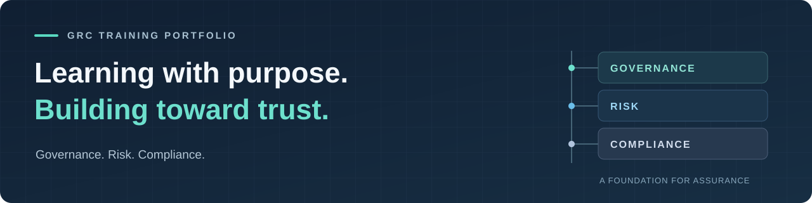

# Joshua

### GRC Trainee · Governance, Risk & Compliance

Preparing for a career in GRC through structured learning, practical exercises, and clear documentation.

[About](#about) &nbsp; / &nbsp; [Learning focus](#learning-focus) &nbsp; / &nbsp; [Portfolio](#portfolio) &nbsp; / &nbsp; [Certifications](#certifications) &nbsp; / &nbsp; [Connect](#connect)

---

## About

I’m training for a career in **Governance, Risk & Compliance (GRC)**. My goal is to understand how organizations identify security risks, establish useful controls, and demonstrate that their requirements are being met.

This profile is the home for my learning journey. As I progress, I’ll share completed practice projects, document what I learn, and add certifications with verification links when I earn them.

> **Current stage:** In training. Building a foundation and developing a portfolio of practical work.

## Learning focus

| Area | What I’m learning toward |
| :--- | :--- |
| **Governance** | How security policies, responsibilities, and objectives support an organization. |
| **Risk management** | How to identify risks, assess likelihood and impact, and document treatment decisions. |
| **Compliance & assurance** | How requirements connect to controls, evidence, and audit readiness. |
| **Professional documentation** | How to make security information clear, organized, and useful to its audience. |

## Portfolio

My portfolio will grow alongside my training. The items below are a **practice roadmap**, with starter templates available for future work.

| Planned practice project | Intended output | Status |
| :--- | :--- | :--- |
| [Risk assessment exercise](./portfolio/risk-assessment-template.md) | A documented scenario, risk register, and treatment rationale. | Planned · template ready |
| [Policy & control exercise](./portfolio/policy-control-template.md) | A sample policy connected to a clear control and supporting evidence. | Planned · template ready |
| [Audit evidence exercise](./portfolio/evidence-checklist-template.md) | An organized checklist showing what evidence supports each control. | Planned · template ready |

[View the portfolio roadmap →](./portfolio/README.md)

## Certifications

### Currently working toward

| Learning goal | Focus | Status |
| :--- | :--- | :--- |
| [Microsoft Certified: Azure Fundamentals (AZ-900)](https://learn.microsoft.com/en-us/credentials/certifications/azure-fundamentals/) | Cloud concepts, Azure services, and governance fundamentals. | In progress |
| [Google Cybersecurity Certificate](https://grow.google/certificates/cybersecurity/) | Foundational cybersecurity knowledge and practical skills. | In progress |
| [GRC Mastery — UnixGuy](https://www.grcmastery.com/) | GRC training and professional development. | In progress |
| [TryHackMe Security Analyst Level 1 (SAL1)](https://tryhackme.com/certification/security-analyst-level-1) | Practical security analysis and investigation. | In progress |
| [CompTIA Security+](https://www.comptia.org/en-us/certifications/security/) | Core security concepts and practices. | In progress |

These are current learning goals; they are not listed as earned credentials.

### A home for future milestones

**No earned certifications are listed yet.** As I earn credentials, this section will display the certification, issuing organization, date, and a public verification link.

| Credential | Issuer | Earned | Verification |
| :--- | :--- | :--- | :--- |
| First earned credential to be added | — | — | — |

<!-- Replace the placeholder row after earning a certification:
| Certification name | Issuing organization | Month YYYY | [Verify credential](https://issuer.example/your-public-credential) |
Do not list a planned or in-progress certification as earned.
-->

[Open the certification showcase →](./certifications/README.md)

## How this portfolio will develop

**Learn the concepts → Practice with a scenario → Document the result → Reflect and improve.**

Completed projects will include their scope, assumptions, deliverables, and lessons learned. Planned work will stay labeled as planned until it is complete.

## Connect

I’m interested in learning from people working in GRC, security governance, risk management, and compliance. Follow my progress and explore my work here on [GitHub](https://github.com/Ten-Inch-Chilada).

<!-- Optional: add a public professional LinkedIn or portfolio link here when ready. -->

---

A developing GRC portfolio. Training, practice work, and earned credentials are labeled separately.
